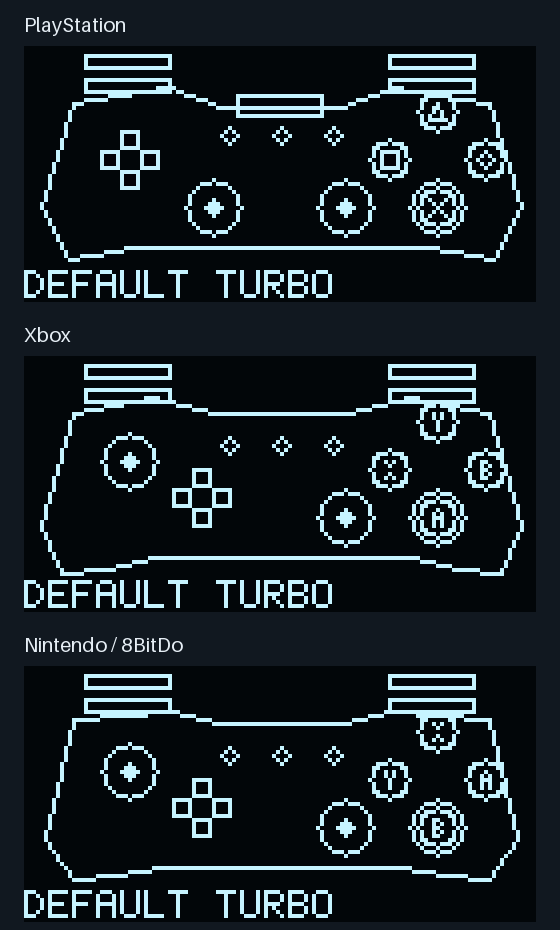
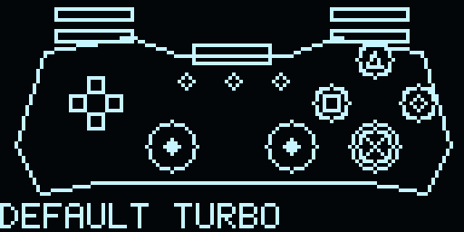
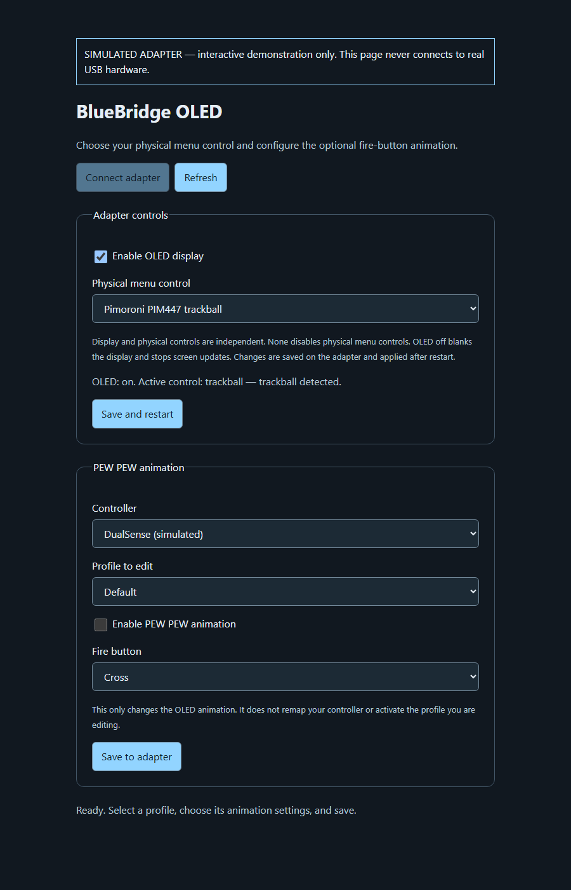

# SSD1306 OLED and rotary encoder

This fork adds a 128x64 SSD1306 display over I2C and a rotary encoder with a
push switch. The default screen shows live controller inputs. A simpler status
screen shows the selected controller/profile, turbo configuration and battery
percentage where available, without fixed branding, USB mode or a routine
Connected label. Text uses a compact uppercase ASCII font.

## Screenshots and demonstrations

These are software-generated examples, not photographs of a flashed adapter.
OLED pixels come from the same C renderer compiled into the firmware. The web
configuration screenshot and interactive demo use a simulated USB adapter.








To try the web GUI without hardware, run this from the repository root:

```sh
python -m http.server 8765 --bind 127.0.0.1 --directory docs/demos
```

Open `http://localhost:8765/oled-config-demo.html`. It never connects to real
USB hardware, starts with a simulated trackball and DualSense, and lets you
change settings/reconnect after a simulated restart.

To regenerate the assets, install Pillow and run:

```sh
python tools/render_demos.py
node tools/render_web_demo.mjs
```

The Python script uses CC/gcc and the firmware C renderer. The web demo is a
generated copy of the real config page with a mock transport. Its screenshot
can be recaptured using a headless browser after the simulated connection loads.
The preview UF2 and checksum are attached to the
[preview release](https://github.com/Soopahfly/MC-BlueBridge/releases/tag/v1.0.6-oled-preview).
See [release notes and pending hardware checks](RELEASE_NOTES-1.0.6-oled-preview.md).

## Live controller screen

The input display follows the behavior of
[GP2040-CE's button layout screen](https://gp2040-ce.info/web-configurator/menu-pages/display-configuration/):
buttons fill when pressed and a separate outer ring identifies turbo assignments.
It is a C adaptation of that display concept with original controller geometry;
the GP2040-CE C++ graphics framework is not included.

Controller identification selects a PlayStation, Xbox, Nintendo/8BitDo or generic
silhouette automatically. PlayStation uses cross/circle/square/triangle; Xbox uses
A/B/X/Y; Nintendo uses B/A/Y/X in physical South/East/West/North positions.
PlayStation sticks are symmetric; Xbox/Nintendo sticks are asymmetric. Common
face buttons, shoulder/trigger inputs, D-pad directions, stick positions/clicks,
and Select/Home/Start are visualized. Model-specific paddles and extra buttons
are not drawn in this first version; a family layout is not an exact model replica.

Highlights show physical normalized inputs before remapping. Turbo rings map
the profile's output assignments back to physical buttons, including macro
triggers. Modifier-selected turbo buttons use live runtime assignments. Rings
remain visible when a button is released or a toggle/hold gate is inactive;
they mean assigned to turbo, not currently emitting a pulse. Disabled turbo and
two-controller mode remove the rings.

The profile name appears below the controller. Display Screen in the menu
switches between Live Controller and Status for the current boot; live view is
the startup default. PEW PEW temporarily takes over either screen and then
restores it. Pairing/waiting messages appear when no selected controller is
connected. Pictures are capped at 20 frames/second while input changes, and
unchanged framebuffer pages still generate no I2C traffic. Unlike a status-only
screen, the live input view intentionally generates display traffic during play.

## Default wiring

Disconnect USB while wiring. Power the OLED and any encoder module at **3.3 V**;
all signal lines must remain at 3.3 V. A bare mechanical encoder needs no VCC:
connect its common terminal and the other push-switch terminal to GND. Firmware
enables internal pull-ups on A, B and the switch.

| Device connection | Pico GPIO / supply | Physical Pico pin |
| --- | --- | --- |
| OLED SDA | GP4 (I2C0 SDA) | 6 |
| OLED SCL | GP5 (I2C0 SCL) | 7 |
| OLED VCC | 3V3 OUT | 36 |
| OLED GND | GND | 8 (or another GND) |
| Encoder A / CLK | GP6 | 9 |
| Encoder B / DT | GP7 | 10 |
| Encoder SW | GP8 | 11 |
| Encoder common / GND | GND | 8 (or another GND) |
| Encoder module VCC, if present | 3V3 OUT | 36 |

The default OLED address is **0x3c**. Some modules use **0x3d**. Most SSD1306
breakouts include I2C pull-up resistors; if yours does not, add suitable pull-ups
from SDA/SCL to 3.3 V (typically 4.7 kohm for short wiring). This implementation
targets common four-pin modules with onboard reset circuitry and charge-pump
power. A bare panel or module needing a separate reset line needs additional work.

Use a quadrature rotary encoder with a push switch. Four signal transitions per
detent is the default; two-transition encoders are configurable. Swap A and B
if rotation feels reversed. No buzzer or audio hardware is used.

For a bare encoder (for example, a Bourns PEC11R with a push switch), connect:

```text
Encoder A ---------------- GP6 (physical pin 9)
Encoder B ---------------- GP7 (physical pin 10)
Encoder common C --------- GND
Push-switch terminal 1 --- GP8 (physical pin 11)
Push-switch terminal 2 --- GND
```

A bare encoder has no VCC connection. Terminal order varies: identify A/B/common
and the two switch terminals from the particular encoder's datasheet.

## Choose OLED and controls in the web GUI

The same panel-enabled firmware includes **None**, **Rotary encoder** and
**Pimoroni PIM447 trackball**. There is no separate trackball firmware selection
or compile-time input-mode switch.

1. Serve `tools/oled-config.html` locally as described under PEW PEW below.
2. Open the page in desktop Chrome/Edge and connect to the adapter over USB.
3. Under **Adapter controls**, set **Enable OLED display** and choose **Physical menu control**.
4. Click **Save and restart**. The setting is stored on the adapter, then the
   adapter restarts if the active selection changed. Reconnect from the page.

This choice is global to the adapter, independent of controller profiles, and
can be configured before any Bluetooth controller is paired. OLED on/off and
physical control choice are independent. **None** leaves both encoder and
trackball inputs uninitialized; the OLED continues working if enabled. It does
not disable controller input, USB management, or the optional OLED animation.
Only the selected physical control is initialized after restart. OLED off sends
one SSD1306 display-off command to blank any retained image, then stops all
display transfers and rendering. Encoder/trackball selection and USB
configuration remain available independently. An absent display is handled by
the existing NACK/timeout path.

Fresh configurations default to OLED on and control None. Older configurations
keep OLED on during migration. Upgrades/imports from schema 7-14 preserve
Encoder as the default to match the previous firmware. There is no automatic
fallback to another input if the selected hardware is absent. You can always
change the selection over USB in a USB mode exposing the management interface.

## Pimoroni PIM447 trackball

The implemented driver targets the **Pimoroni PIM447 I2C RGBW Trackball Breakout**,
not bare direction-output BlackBerry trackball boards. The register map and
20 ms register-pointer/read spacing follow Pimoroni's official
[Python driver](https://github.com/pimoroni/trackball-python) and
[Pico library](https://github.com/pimoroni/pimoroni-pico/tree/main/drivers/trackball).
This project uses its own non-blocking C implementation, not those libraries.

Default wiring uses a dedicated **I2C1 bus at 100 kHz**, separate from the OLED:

| PIM447 connection | Pico GPIO / supply | Physical Pico pin |
| --- | --- | --- |
| VCC / 3-5V | 3V3 OUT | 36 |
| GND | GND | 38 (or another GND) |
| SDA | GP2 (I2C1 SDA) | 4 |
| SCL | GP3 (I2C1 SCL) | 5 |

The OLED remains on GP4/GP5. Use 3.3 V with the Pico. Four wires are sufficient;
the trackball INT connection is not used. The default device address is 0x0a;
0x0b is supported through the build option for boards configured to that address.
The driver checks chip ID 0xba11 before accepting input or writing LEDs.

- Roll up/down to browse menu items.
- Roll left/right to adjust a selected value.
- Roll in either axis from the normal screen to open the menu.
- Click to select/apply; hold for 0.8 seconds to cancel/back.
- Click-induced movement is suppressed. A minimum motion threshold, dominant-axis
  filter, 80 ms step spacing and three-step burst cap limit accidental changes.
- Register switch-change counts catch short taps completed between reads.

LED feedback is low brightness and changes only when needed:

| State | Illumination |
| --- | --- |
| Waiting for controller | Amber |
| Controller connected | Green |
| Pairing | Blue |
| Menu open | Purple |
| Editing a setting | White |
| PEW animation | Red briefly |

I2C reads/writes are serviced in bounded FIFO steps on core 1 without blocking
on clock stretching. Input sampling uses a 20 ms pointer/read gap and a short
interval before the next sample. A NACK, wrong chip ID, or 100 ms without progress
disables trackball input for that boot. Loss while held does not synthesize an
Apply click. Fix wiring and power-cycle, or select a different input in the GUI.
A failed I2C connection cannot reliably update the trackball's LED state.

Optional build-time wiring/sensitivity overrides (the input type is still chosen
in the GUI):

```text
BB_TRACKBALL_I2C=1
BB_TRACKBALL_SDA=2
BB_TRACKBALL_SCL=3
BB_TRACKBALL_ADDRESS=0x0a
BB_TRACKBALL_COUNTS_PER_STEP=3
BB_TRACKBALL_INVERT_X=OFF
BB_TRACKBALL_INVERT_Y=OFF
```

Counts per step accepts 1-32. Increase it if navigation is too sensitive. X/Y
inversion supports reversing the mounted orientation; axis swapping is not
implemented. These wiring/sensitivity overrides are not web-GUI settings.
**The trackball implementation has automated tests and compiles, but has not
been validated with a physical PIM447 or for controller-latency impact.**

## Navigation

- Press or turn from either normal screen to open the menu.
- Turn to choose a setting; press to edit it.
- Turn to preview a value; press again to apply/save it.
- Hold for 0.8 seconds to cancel an edit, or return from the menu to the selected screen.
- Select Back to return to the selected screen.

Menu settings:

| Item | Action |
| --- | --- |
| USB mode | Choose one of the five existing output modes; confirmation re-enumerates USB. |
| Controller | Choose which remembered controller to configure/view. Does not disconnect the others. |
| Profile | Choose the selected controller's active profile. MiSTer identity changes re-enumerate USB as before. |
| Turbo | Enable/disable the selected profile's turbo configuration. |
| Turbo rate | Set 1-30 Hz. |
| Turbo control | Choose modifier, toggle or hold control. |
| Turbo button | Choose the modifier/control input button for that control method. |
| Turbo output | Choose an output button; press to toggle its membership in the saved turbo mask. Repeat for more buttons. |
| PEW PEW | Enable/disable the optional OLED-only animation for the selected profile. |
| Fire button | Choose which canonical input button triggers the animation. |
| Pairing | Start or stop pairing. Starting is refused if both slots are occupied. |
| Controller mode | Choose single/two controllers. Applying saves and restarts the adapter. |
| Display screen | Choose Live Controller or Status for the current boot. |

Existing turbo semantics are preserved: modifier mode selects turbo outputs
using modifier+button presses at runtime. Toggle/hold modes use the saved turbo
output mask. Setting turbo output buttons does not remap the controller.

Two-controller mode remains MiSTer-only. USB mode and turbo items are unavailable
in that mode. Select Controller to view/configure either controller; the status
screen and cosmetic animation follow the selected controller. Settings can also
be edited for remembered controllers while disconnected.

## PEW PEW checkbox

The animation is **off by default**, stored per controller/profile, and has no
effect on gamepad output. It watches the chosen input button before remapping,
not a game-specific fire action. The default trigger is South (canonical input 0).
Actual press edges trigger a 400 ms full-screen comic burst: `PEW` at top centre,
then a tilted `PEW` at left and another at right. There is no character or mascot;
the previously selected live/status screen returns afterwards. Held buttons and
generated turbo pulses do not retrigger it. New effects start at most once every
750 ms; the menu takes priority. Button
capture/tester mode suppresses new effects.

To use the configuration checkbox on a computer:

```powershell
cd tools
python -m http.server 8765 --bind 127.0.0.1
```

Open **http://localhost:8765/oled-config.html** in desktop Chrome or Edge, click
Connect adapter and select its USB serial port. Choose a controller/profile,
tick **Enable PEW PEW animation**, choose Fire button and save. Selecting a
profile in this page edits its animation settings without activating it.
Close other software using the adapter's serial port first.

This repository does not contain the external MiSTer Companion/BlueBridge web
app. Their existing UI will not acquire the checkbox automatically. This local
page supplies it; the protocol below allows those apps to integrate it later.
The local page cannot reach the management interface while native Xbox 360
console mode is active. The encoder menu remains available in that mode.

## Build configuration

Validated with **Pico SDK 2.3.1**, its pinned BTstack, Arm GNU Toolchain
14.3.Rel1, CMake and Ninja. The original firmware requires the newer BTstack
`hids_host` API; SDK 2.2.0 does not provide it. Ensure SDK submodules `lib/btstack`,
`lib/tinyusb`, `lib/cyw43-driver` and `lib/mbedtls` are initialized. The libxsm3
dependency follows the existing CMake configuration.

OLED/encoder support is enabled by default in this fork. Override any wiring
at configure time:

```sh
cmake -S . -B build -G Ninja -DPICO_BOARD=pico2_w \
  -DBB_ENABLE_OLED=ON -DBB_OLED_I2C=0 \
  -DBB_OLED_SDA=4 -DBB_OLED_SCL=5 -DBB_OLED_ADDRESS=0x3c \
  -DBB_ENCODER_A=6 -DBB_ENCODER_B=7 -DBB_ENCODER_SW=8 \
  -DBB_ENCODER_STEPS=4
cmake --build build
```

Use `-DBB_ENABLE_OLED=OFF` for a build with no panel GPIO/I2C initialization.
The configuration/protocol fields remain supported so saved settings survive
switching between builds. GPIOs must be distinct exposed pins, with a valid
SDA/SCL pair for the selected I2C peripheral. The panel owns that peripheral.

On this Windows checkout, `tools/build.ps1` uses the project-local build tools
under `.build-tools` when present, otherwise tools on PATH and `PICO_SDK_PATH`.
It does not download or install tools. `tools/build.ps1 -WithoutOled` creates
the corresponding `build-no-oled` build. Extra options can be supplied through
`-CmakeArgs @('-DBB_OLED_ADDRESS=0x3d')`.

## Flashing and first use

1. Export your existing adapter configuration through its management interface.
2. Build the firmware. The default output is `build/mc_bluebridge.uf2`; a
   panel-disabled Windows-script build uses `build-no-oled/mc_bluebridge.uf2`.
   These generated binaries and the local tool downloads are not committed to
   the repository. UF2 packaging requires Raspberry Pi's picotool; do not set
   `PICO_NO_PICOTOOL=1` if you need the UF2 output.
3. Unplug the Pico. Hold BOOTSEL while reconnecting USB to a computer, then
   release it when the Pico bootloader drive appears.
4. Copy the UF2 to that drive. The Pico restarts into the firmware automatically.
5. Connect/pair a controller. Live Controller is the default screen. Open the
   encoder menu and choose Display Screen to switch to Status if preferred.
6. To enable the optional effect, select the intended Controller and Profile,
   then set PEW PEW to enabled and choose Fire Button. Alternatively use the
   local configuration page described above. Power-cycle to check persistence.

PEW settings persist per profile. The Live Controller/Status screen selection is
currently session-only and resets to Live Controller after restarting. The old
firmware cannot read schema 16; keep your pre-upgrade export if you intend to
return to it. To use a trackball instead of the encoder, choose Trackball under Adapter
controls in the local web GUI and save/restart.

## Management protocol and persistence

The BB1 wire format and protocol version 2 are retained. `HELLO` advertises
`profile_oled: true` and `oled_panel` indicating build-time panel support.
`PROFILE_GET` adds JSON fields `oled_pew_enabled` and `oled_fire_button`.

```text
BB1|request-id|PROFILE_OLED|profile-index|enabled-0-or-1|input-button-0-to-25
BB1|request-id|OK|saved
```

The command acts on the selected management controller. Invalid indices,
boolean values and button numbers are rejected.

Configuration schema **16** appends one OLED-enable byte to schema 15.
Schema 15 appended one adapter-control selection byte to schema 14. Schema 14 already appended the 64-byte per-controller/profile PEW
table to schema 13, preserving the original profile/controller binary layout.
Schema 7-15 flash records migrate; schema 8-15 exports remain importable.
Schema-14 PEW settings survive migration. Older animation-less profiles start
with the effect disabled. Duplicating copies it; deleting profiles/controllers
shifts it with its owner, and new profile slots start off.
The current payload is 11,046 bytes, within the reserved 16 KiB. Export a backup
before flashing; earlier firmware will not understand schema 16.

`HELLO` also advertises `panel_configuration: true` and `oled_toggle: true`. The adapter-level commands
are independent of controller selection:

```text
BB1|request-id|PANEL_GET
BB1|request-id|OK|{"input":"trackball","active_input":"trackball","restart_required":false,"panel_compiled":true,"oled_enabled":true,"active_oled_enabled":true,"trackball_ready":true}
BB1|request-id|PANEL_SET|none
BB1|request-id|PANEL_SET|encoder
BB1|request-id|PANEL_SET|trackball
BB1|request-id|PANEL_SET|trackball|0
BB1|request-id|PANEL_SET|none|1
```

`PANEL_SET` replies with JSON containing `input` and `restart_required`. Unsupported
names, invalid OLED booleans and extra fields are rejected before changes.
An optional final `0`/`1` field sets OLED off/on atomically with the input choice;
omitting it preserves the current saved OLED preference for older clients.
Changed settings are persisted and restart the adapter. Reapplying active
settings needs no restart. `panel_compiled` reports build support separately
from the saved `oled_enabled` and boot-time `active_oled_enabled` values. A firmware built
with `BB_ENABLE_OLED=OFF` only accepts None with the display off. The separate Companion website/app
would need to implement these commands to expose the selector; the included
local web page already provides it.

## Runtime overhead and failure handling

- No periodic framebuffer transmission. Status is sampled in RAM at most every
  20 ms; unchanged text is not rasterized and unchanged pages are not transmitted.
- The SSD1306 owns the displayed image between updates. Changed 128-byte pages
  are sent at 400 kHz over hardware I2C.
- FIFO service queues at most 16 bytes per USB-loop call and never waits for
  bus progress, so a screen transfer does not block for its wire time.
- Display storage uses two 1,024-byte image buffers, a 135-byte in-flight packet
  and small text/state buffers. The full panel additionally holds a controller
  snapshot and menu state.
- Encoder IRQs only decode quadrature and accumulate movement; menu actions and
  persistence happen on core 1. Turning the knob does not save flash until a
  value is confirmed.
- A NACK or 100 ms without transfer progress disables the display for that boot,
  avoiding repeated traffic when absent or miswired. Reconnect power after fixing
  wiring. Encoder operation remains independent of display detection.
- Bluetooth callbacks never draw or perform I2C transfers.

The panel-enabled firmware includes the OLED renderer, encoder and trackball
code, while initializing only the selected input. Compare
`arm-none-eabi-size` for enabled/disabled builds when assessing memory overhead;
these figures exclude transient stack use and are not latency measurements.

## Validation and hardware bring-up

```sh
python tests/run.py
node tests/test_config.mjs
```

Native C tests cover encoder direction/bounce/hold/wrap, fire edges/capture,
profile/controller lifecycle, flash checksums and migration, menu confirmation,
turbo controls, animation timing, multi-controller restrictions, idle I2C
suppression, changed pages, in-flight changes, NACK and stuck-bus timeouts.
Controller-renderer tests cover family selection, press fills, released-button
turbo rings, stick/D-pad/trigger changes, remapped turbo rings, and the real input
pipeline's modifier-selected turbo assignments. Renderer tests write sample
128x64 monochrome PBM frames under `build-host/` for inspection.
The JavaScript test exercises the actual checkbox page with simulated Web Serial,
including split replies, saved values, stale-profile protection, all three
physical-control selections, OLED on/off, reconnect after restart and setup
before pairing. Native display tests verify one display-off command followed
by no further screen traffic.
Trackball tests cover motion thresholds/inversion/jitter/rate limiting, register
read timing, chip identity, short/held clicks, LED caching, device loss, NACK and
timeouts, plus shared menu interaction.

Builds and simulations do **not** validate physical wiring or controller latency.
On hardware, first verify the status screen and encoder direction, then mode
changes/pairing, per-profile persistence after unplugging, and the optional effect.
Finally compare Bluetooth/USB report and dropped-report diagnostics with the panel
enabled/disabled, including turbo and two-controller operation.

## Bluetooth performance and reliability diagnostics

The [implementation checklist](LATENCY_PLAN.md) records software checks separately
from physical validation. Version 1.0.6 keeps controllers on Bluetooth; USB is
still the output to MiSTer. The screen/PEW/trackball features remain available.

The USB management protocol accepts these newline-terminated commands:

```text
BB1|1|USB_QUEUE
BB1|2|SAVE_STATUS
```

`USB_QUEUE` returns a `slots` array with current `depth`, `high_water`,
`overflows`, `oldest_age_ms` and `max_age_ms`. Age is time waiting inside the
adapter's USB queue, not radio delay or button-to-screen latency. Up to eight
edge reports are retained per slot; longer host stalls can overflow and are
counted. Analog values coalesce while button/hat/trigger pressed states agree.

`SAVE_STATUS` returns `pending` and the boot's cumulative `failures`. Saves batch
for 250 ms, with a maximum initial batch window of 1 s. Failed saves retry at
most once per second and prevent a requested settings restart. Keep the adapter
powered while pending. Identical flash images skip erase/program. Flash writes
still pause the processor; this firmware reduces their frequency.

For comparison, use the same Bluetooth controller, distance, MiSTer core and
host settings. Record queue counters with OLED on/off, PEW off/on, turbo off/on
and one/two controllers. The optional no-OLED UF2 provides a compile-time panel
baseline. Reboot between runs to reset queue statistics. Inspect rapid taps and
trigger press/releases under host load; queue metrics alone cannot establish
end-to-end latency. Pairing, physical controls, stack high-water and actual
button-to-output timing still need hardware testing.

`tools/build.ps1` now runs `tools/check_stack.py` after building. The audit checks
project frame reports and the two 4 KiB stack reservations; it cannot prove all
SDK/libc/interrupt nesting or replace runtime high-water measurements.
